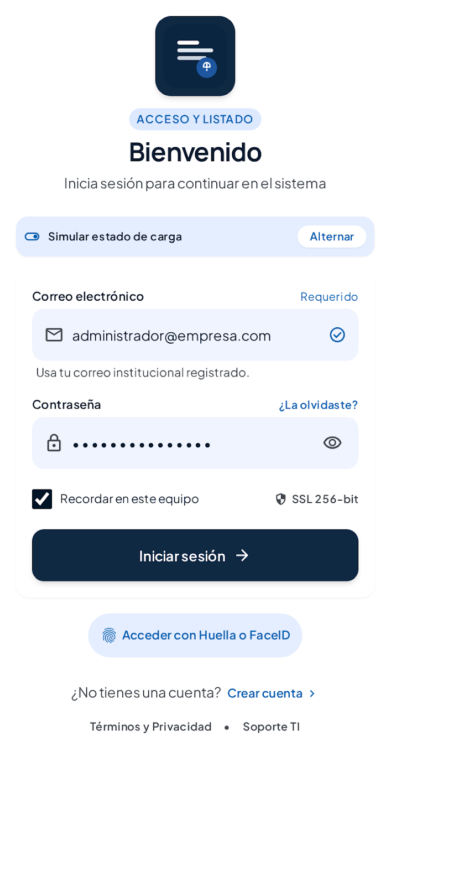
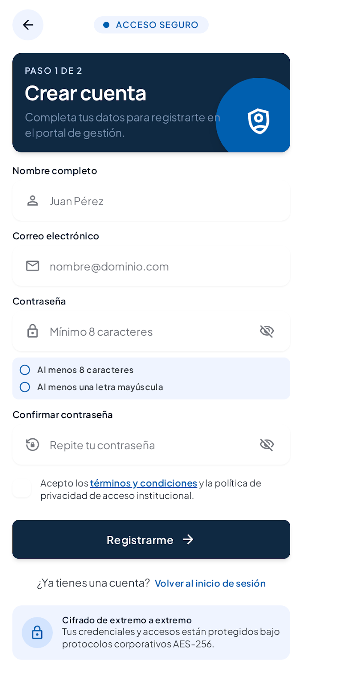
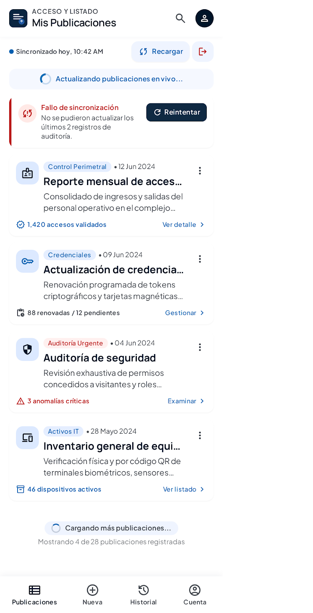
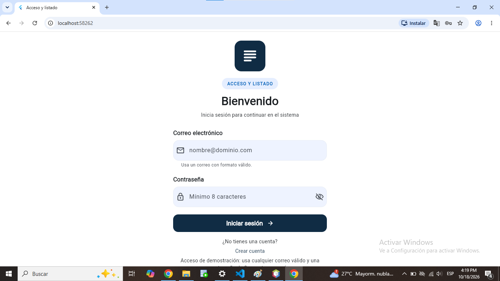
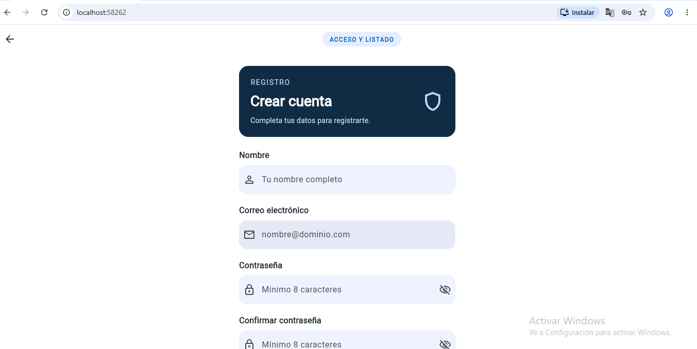
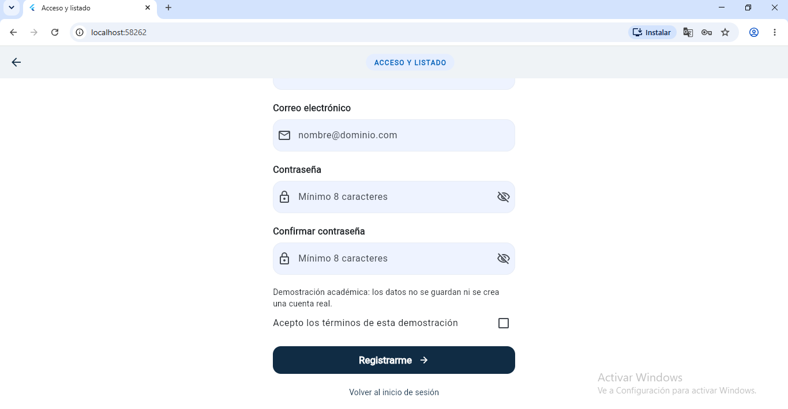
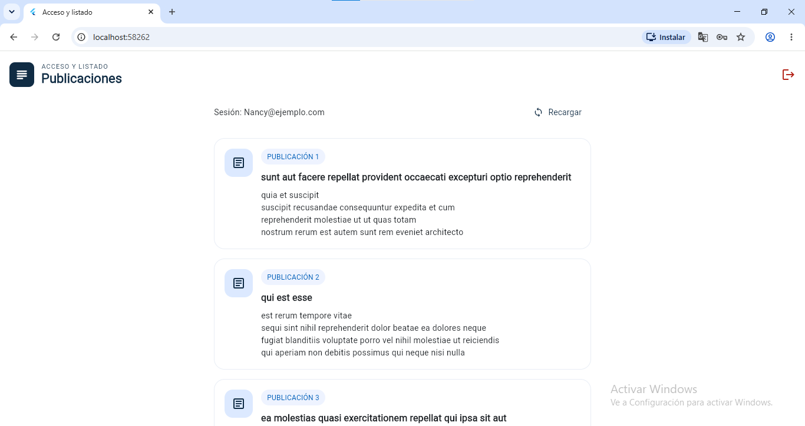

# Acceso y Listado — Parcial 2

Proyecto de Flutter para el Parcial 2 de Desarrollo de Aplicaciones Móviles de la USAM. La aplicación permite practicar formularios, validaciones, navegación, estado con Riverpod y consumo de una API REST. Tiene tres pantallas: Login, Registro y Listado.

El diseño usa fondo blanco, azul oscuro, campos redondeados y tarjetas, tomando como referencia los diseños de Google Stitch incluidos en este repositorio.

## Funcionalidades

### Login

- Valida el formato del correo y una contraseña de mínimo 8 caracteres.
- Simula el inicio de sesión con `Future.delayed` de 1500 ms.
- Muestra un indicador y deshabilita el botón mientras espera para evitar solicitudes repetidas.
- Muestra mensajes de validación y permite abrir Registro.
- Al ingresar, elimina las rutas anteriores para que Atrás no vuelva al Login.

El acceso es una simulación: cualquier correo con formato válido y una contraseña de al menos 8 caracteres permiten entrar. No hay autenticación real ni almacenamiento de contraseñas.

### Registro

- Solicita nombre, correo, contraseña, confirmación y aceptación de términos de la demostración.
- Compara la confirmación con el valor de la contraseña obtenido mediante su `TextEditingController`.
- Si cambia la contraseña después de escribir la confirmación, vuelve a validar que coincidan.
- Devuelve el correo al Login con `Navigator.pop`; Login lo coloca automáticamente en su campo.

El registro no crea una cuenta real ni guarda los datos.

### Listado

- Consume publicaciones de JSONPlaceholder en páginas de 15 elementos.
- Carga automáticamente la siguiente página al acercarse al final mediante scroll infinito.
- Distingue carga, datos, error y lista vacía.
- Permite actualizar con Recargar o deslizando hacia abajo con `RefreshIndicator`.
- Muestra los errores junto a Recargar, con un botón Reintentar visible.
- Conserva las publicaciones cargadas si falla una petición.
- Permite cerrar sesión y volver al Login.

## Cómo ejecutar la aplicación

Se necesita Flutter con Dart compatible con `sdk: ^3.13.0`, como indica `pubspec.yaml`, y un dispositivo o navegador disponible. Desde la carpeta `acceso_listado`:

```sh
flutter pub get
flutter devices
flutter run
```

Para ejecutar en Chrome:

```sh
flutter run -d chrome
```

Para elegir otro dispositivo, usa `flutter run -d ID`, reemplazando `ID` por el que muestre `flutter devices`.

El listado requiere conexión a Internet. Android tiene el permiso INTERNET y macOS tiene permisos de conexión saliente para debug y release. No se han verificado todas las plataformas.

Se conservaron las dependencias existentes. `pubspec.lock` resuelve `flutter_riverpod` a la versión **3.4.3**; conviene conservarlo para reproducir esa versión.

## Organización y funcionamiento del código

| Archivo | Qué contiene |
| --- | --- |
| `lib/main.dart` | Inicio con `ProviderScope`, aplicación y tema visual. |
| `lib/pantallas/login.dart` | Formulario de acceso, carga y navegación al Listado o Registro. |
| `lib/pantallas/registro.dart` | Formulario de registro, validación cruzada y devolución del correo. |
| `lib/pantallas/listado.dart` | Tarjetas, scroll infinito, refresco, aviso de error y cierre de sesión. |
| `lib/estado/sesion.dart` | Estado de sesión con Riverpod; guarda el correo en memoria. |
| `lib/estado/listado.dart` | Publicaciones, carga, error, página siguiente y fin de datos. |
| `lib/servicios/publicaciones_servicio.dart` | Peticiones HTTP y conversión de errores a mensajes comprensibles. |
| `lib/modelos/publicacion.dart` | Modelo con identificador, título y contenido de cada publicación. |
| `lib/utilidades/validaciones.dart` | Validaciones de nombre, correo, contraseña y confirmación. |
| `lib/widgets/campo_texto.dart` | Campo reutilizable utilizado por Login y Registro. |
| `lib/widgets/marca_acceso.dart` | Marca y etiqueta visual compartidas. |
| `test/widget_test.dart` | Siete pruebas de formularios, servicio, estado y navegación. |
| `test/conexion_test.dart` | Dos pruebas de desconexión, conservación de datos y reintento. |

### Riverpod y sesión

Riverpod permite compartir el estado entre pantallas sin guardarlo únicamente en una variable local. `sesionProvider` conserva el correo del usuario y `listadoProvider` maneja los datos del Listado. `ref.watch` actualiza la interfaz cuando cambia el estado y `ref.read(...notifier)` ejecuta acciones.

La sesión solo existe en memoria mientras se usa la aplicación. Cerrar sesión elimina el correo e invalida el estado del listado.

### Navegación y validaciones

Login utiliza `pushAndRemoveUntil` para abrir el Listado y eliminar las rutas anteriores. Registro utiliza `Navigator.pop(context, correo)` para devolver el correo a Login. Cerrar sesión vuelve al Login eliminando también las rutas anteriores.

Los formularios usan `Form`, validadores y controladores. En Registro, la confirmación lee `_contrasena.text`; al cambiar la contraseña se llama de nuevo a la validación de la confirmación si ya tiene texto. Los controladores se liberan con `dispose`.

Después de las operaciones asíncronas de Login se comprueba `mounted` antes de usar el contexto. En los manejadores de Riverpod se utiliza `ref.mounted` antes de actualizar el estado tras una espera.

`CampoTexto` evita repetir las etiquetas, iconos, validadores, mensajes de error y la opción de mostrar u ocultar contraseñas en Login y Registro.

### Servicio HTTP y paginación

Las peticiones están separadas de las pantallas en `PublicacionesServicio`. La primera consulta es:

```text
https://jsonplaceholder.typicode.com/posts?_page=1&_limit=15
```

Cada petición correcta avanza una página. Si llegan menos de 15 publicaciones, se marca que no hay más datos. JSONPlaceholder ofrece 100 publicaciones, por lo que la última página contiene 10.

`ScrollController` detecta cuándo quedan menos de 250 píxeles por recorrer y solicita la siguiente página. También se comprueba el espacio disponible después de dibujar la lista para completar pantallas altas. No hay un botón Cargar más. La bandera `cargando` evita peticiones duplicadas y el controlador se libera en `dispose`.

### Recargar, errores y Reintentar

Recargar y `RefreshIndicator` vuelven a solicitar la página 1. Si la petición funciona, reemplazan la lista y reinician la paginación. Si ya hay una petición en curso, se evita lanzar otra.

El servicio solicita revalidar la caché con `Cache-Control: no-cache`, limita la espera a 15 segundos y convierte los errores HTTP, de conexión y de datos en mensajes comprensibles. Un fallo de conexión muestra: “No se pudo conectar. Revisa tu conexión a Internet y presiona Reintentar.”

El aviso aparece debajo de Recargar, para que no quede oculto después de todas las tarjetas. Si falla una petición, se conservan las publicaciones anteriores y no se avanza la página. Reintentar repite la petición que falló: la página 1 si era una recarga, o la página pendiente si era scroll infinito. Esto también permite reintentar una recarga después de llegar a las 100 publicaciones.

## Validación y pruebas

En la última ejecución verificada durante el desarrollo:

| Comando | Resultado |
| --- | --- |
| `flutter analyze` | **Sin observaciones: No issues found!** |
| `flutter test` | **9 pruebas aprobadas: All tests passed!** |

Para repetir las comprobaciones:

```sh
flutter analyze
flutter test
```

Las pruebas cubren validaciones, servicio HTTP, datos inválidos, paginación, bloqueo de duplicados, fin de datos, lista vacía, refresco, scroll infinito, navegación, sesión y registro. Las dos pruebas de conexión comprueban que una recarga fallida conserva 100 publicaciones y permite reintentar desde la página 1, y que el fallo de una página posterior conserva los datos y reintenta esa misma página.

Las peticiones de estas pruebas usan `MockClient`: simulan las respuestas y los fallos de red. Estos resultados no significan que se haya realizado una comprobación manual de Offline en Chrome DevTools ni que se hayan probado todas las plataformas. No se volvieron a ejecutar las pruebas al editar únicamente este README.

## Diseños originales de Google Stitch

[Ver el proyecto original en Google Stitch](https://stitch.withgoogle.com/projects/15577785003664377675)

### Login



### Registro



### Listado



### Prompt original de Stitch

El siguiente texto es el prompt original proporcionado para esta entrega:

```text
Diseña una aplicación móvil llamada Acceso y Listado, en español, con tres pantallas para implementar en Flutter. Estilo moderno, sencillo y profesional, fondo blanco, detalles azul oscuro, campos redondeados y botones accesibles.
Pantalla 1 - Login: título Bienvenido, campo Correo electrónico, campo Contraseña con opción de mostrar u ocultar, botón Iniciar sesión y enlace Crear cuenta. Incluye un estado visual de carga.
Pantalla 2 - Registro: título Crear cuenta, campos Nombre completo, Correo electrónico, Contraseña y Confirmar contraseña, casilla Acepto los términos y condiciones, botón Registrarme y enlace Volver al inicio de sesión. Incluye espacio para mensajes de validación.
Pantalla 3 - Listado: encabezado Mis publicaciones, lista vertical de tarjetas con título y descripción, indicador de carga, botón Reintentar para errores, opción de recargar, indicador para cargar más elementos y botón Cerrar sesión.
Mantén los mismos colores, tipografía y componentes en las tres pantallas. Genera tres diseños móviles separados, uno para cada pantalla.
```

## Capturas de la aplicación funcionando en Flutter

Estas capturas reales están guardadas en `docs/capturas`. Las imágenes de Stitch de la sección anterior se conservan como referencias de diseño.

### Login



### Registro — captura 1



### Registro — captura 2



### Listado



**Error de conexión y Reintentar:** [Pendiente: agregar captura real de Flutter].

## Dos diferencias entre Stitch y Flutter

1. **Validación de contraseña:** el diseño de Registro muestra una condición de letra mayúscula, además de la longitud. Flutter exige únicamente el mínimo de 8 caracteres solicitado por el parcial y muestra errores reales junto al campo. Esto mantiene las indicaciones coherentes con la validación implementada y evita rechazar una contraseña por una regla que no se pidió.
2. **Estados del Listado:** la imagen de Stitch presenta carga y error al mismo tiempo. Flutter muestra esos estados según el resultado de la petición: durante la carga aparece un indicador y, si falla, aparece un aviso visible con Reintentar. Se conservan las publicaciones anteriores. Así se comunica el estado real y se permite recuperarse del fallo sin perder los datos que ya se habían cargado.

## Uso de IA

Se utilizó **Google Stitch** como apoyo para generar los diseños visuales de referencia de Login, Registro y Listado. Se incluyen las tres imágenes, el enlace del proyecto y el prompt original proporcionados para la entrega.

Se utilizó **OpenAI Codex** para apoyar la escritura y organización del código Flutter, la preparación de pruebas y la documentación. Durante el desarrollo con Codex se revisó el código contra los requisitos del parcial, se ejecutaron el análisis y las pruebas, y se corrigieron las observaciones encontradas.

La implementación inicial se modificó para acercar colores, encabezados, campos y tarjetas a las imágenes de Stitch. También se ajustó el listado para mantener el scroll infinito automático, mostrar el error junto a Recargar y reintentar la petición correcta conservando los datos anteriores.

Del diseño se conservaron los elementos necesarios para las tres pantallas. Se dejaron fuera funciones adicionales como biometría, auditorías y mensajes de cifrado AES-256, porque no forman parte de esta demostración ni de los requisitos implementados.

No se documenta aquí una revisión personal de cada línea por parte de la estudiante ni pruebas manuales que no se hayan realizado. Antes de entregar, queda pendiente revisar y comprender el código, completar la captura de error de conexión y Reintentar y registrar cualquier modificación personal que se haga.

## Pendientes para la entrega

- Agregar la captura real de error de conexión y Reintentar; las cuatro capturas de Login, Registro y Listado ya están incluidas.
- Comprobar manualmente Login, Registro, navegación con Atrás, scroll infinito y cierre de sesión.
- Probar Recargar con Network → Offline en Chrome DevTools; volver a No throttling y comprobar Reintentar.
- Completar la revisión personal del código para poder explicar las decisiones y el funcionamiento.
